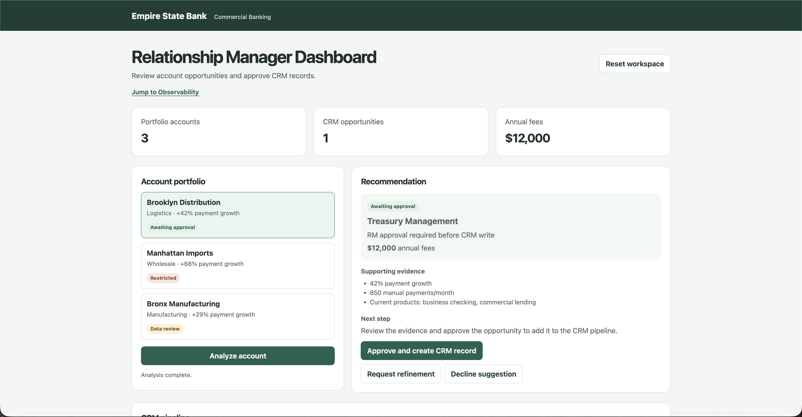
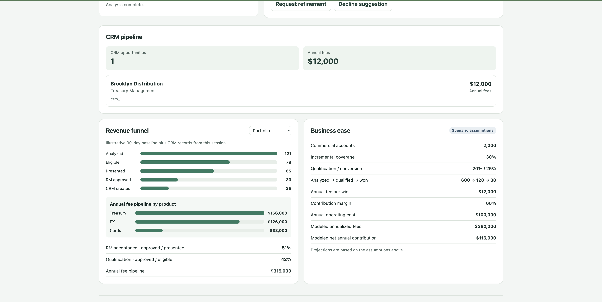
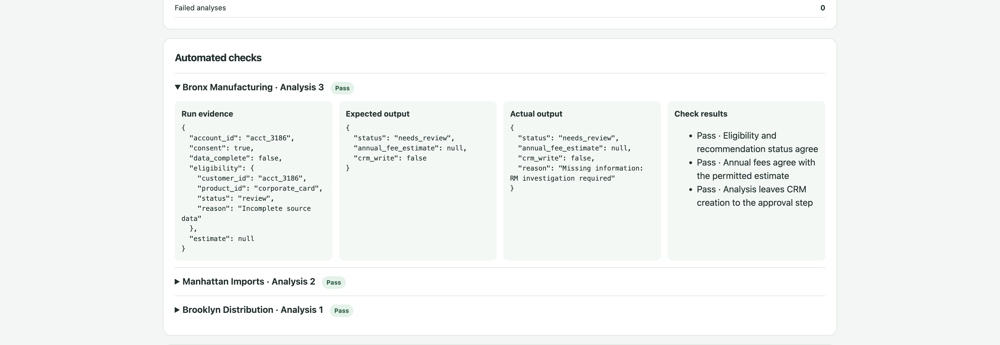
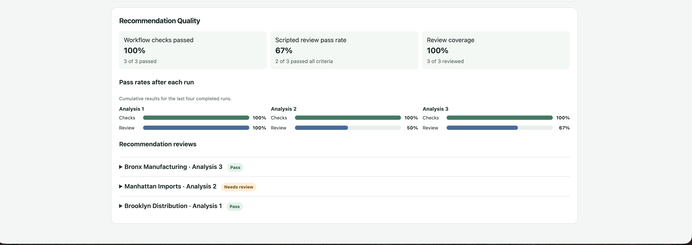

# Commercial Banking Opportunity Agent

Relationship managers use this prototype to identify cross-sell opportunities for existing commercial clients. It reviews payment activity, current products, and eligibility, then presents a recommendation with supporting evidence, estimated annual fees, and a next step. The relationship manager can approve it for the CRM pipeline, request refinement, or decline it.

The goal is to spend less time gathering information and more time deciding which opportunities are worth pursuing. The dashboard shows how recommendations progress from analysis to CRM, and the execution trace lets reviewers inspect the evidence and policy decisions behind each run.

## Design decisions

- **Keep approval with the relationship manager.** Application code enforces account access and product eligibility, and rechecks eligibility before an approved opportunity can be written to CRM.
- **Make each decision reviewable.** The trace records model turns, tool inputs and outputs, and policy decisions. Completed analyses are checked against the evidence collected during the run.
- **Run locally with predictable inputs.** A scripted adapter follows the OpenAI Responses API tool-calling format. Account data and CRM records are simulated and stored in memory. Pipeline fees are estimates. The [measurement contract](docs/MEASUREMENT_CONTRACT.md) describes how a pilot would measure realized fees and incremental lift.

## Run locally

Requires Node.js 20+.

```bash
npm ci
npm run build
npm start
```

Open [the dashboard](http://127.0.0.1:3000/). Run `npm test` after building to check the workflow and guardrails.

## Screenshots

<details open>
<summary>Relationship manager dashboard</summary>



</details>

<details>
<summary>CRM pipeline and revenue funnel</summary>



</details>

<details>
<summary>Automated checks</summary>



</details>

<details>
<summary>Recommendation quality</summary>



</details>
